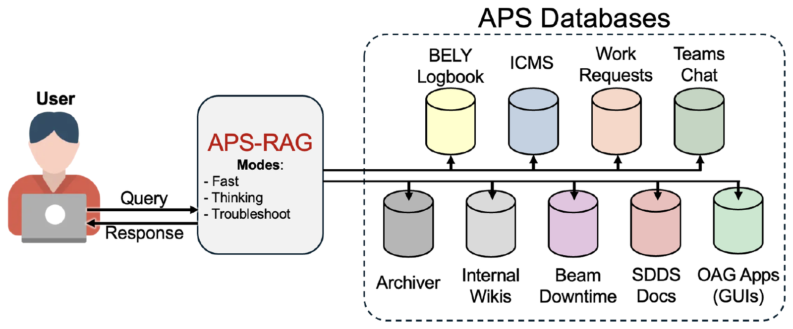
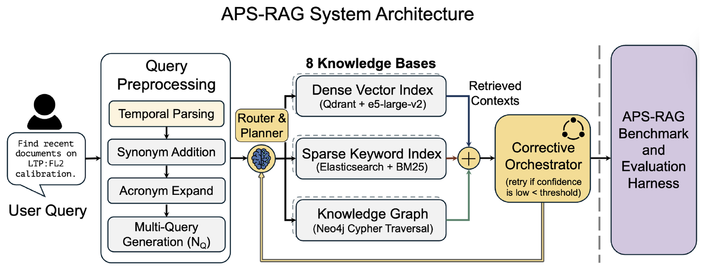
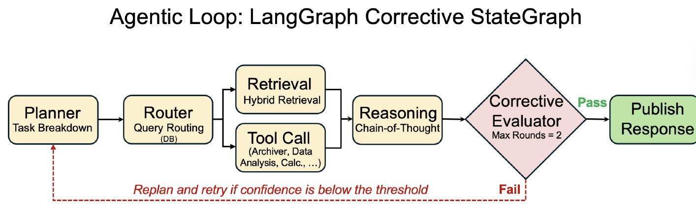

# APS-RAG

A corrective agentic hybrid RAG system for answering questions over a
scientific facility's operational records, with cited answers.

[Paper](https://arxiv.org/abs/2607.24663) | [Getting started](#getting-started) | [Citation](#citation)

<p align="center">
  
</p>

Large facilities keep their operational knowledge in many places at once:
logbooks, technical documents, work requests, chat threads, wikis and live
control-system data. APS-RAG gives staff one natural-language interface to all
of it. Every answer cites the records it was drawn from, so the reader can check
each claim. The system is deployed at the Advanced Photon Source (APS) at
Argonne National Laboratory, where it covers eight indexed knowledge bases plus
live EPICS Archiver data.

This repository contains the platform code: ingestion, hybrid retrieval, the
corrective agentic loop, the knowledge-graph builder, the MCP tool servers and
the API. It is not tied to APS. You can point it at your own documents and any
OpenAI-compatible LLM.

## How it works

<p align="center">
  
</p>

A query is first expanded. The system resolves dates ("last week"), adds
synonyms, expands acronyms and writes a few paraphrases. A router then sends it
to three retrieval channels:

- dense vectors (Qdrant, `e5-large-v2`)
- BM25 keyword search (Elasticsearch)
- an optional Neo4j knowledge graph of faults, components and their resolutions

The results are merged with reciprocal-rank fusion. The fusion weights depend on
the query type: causal and troubleshooting questions lean on the graph, while
factual and date-specific questions lean on BM25. A cross-encoder then reranks
the merged list and the top passages go to the LLM.

<p align="center">
  
</p>

In agentic mode, a LangGraph state machine plans the task and routes it to
retrieval or to tools (archiver, data analysis, calculator). It then drafts an
answer and scores how well that draft is supported by the evidence. If the score
is too low, it broadens the search and tries again, for at most two extra
rounds. A short self-critique pass checks citations and concision before the
answer is returned.

## Results

The paper evaluates the system on APS-Bench, 50 questions built from the APS
corpus with nugget-annotated gold answers.

| System | Retrieval | Strict vital recall (%) | Hallucination rate (%) |
| --- | --- | :---: | :---: |
| Naive RAG | BM25 | 63.8 | 11.2 |
| Hybrid RAG | Vector + BM25 | 65.5 | 9.4 |
| Agentic RAG | Vector + BM25 | 66.1 | 7.9 |
| GraphRAG | Vector + BM25 + KG | 69.1 | 11.3 |
| Agentic GraphRAG (deployed) | Vector + BM25 + KG | **70.3** | 8.7 |

Every retrieval-augmented variant improves on the BM25 baseline, but at n = 50
the differences between variants are not statistically significant. The one
component with a clear effect is the cross-encoder reranker. Replacing it with
LLM relevance scoring lowers strict vital recall by 32.8 points (95% CI
[−47.4, −19.1]). The corrective loop and self-critique gate mostly reduce
hallucination rather than raise recall. Ablations, retrieval metrics and the
judging protocol are described in the paper.

## Getting started

You will need Python 3.10–3.13 (3.11 recommended), Docker for Qdrant and
Elasticsearch, and an OpenAI-compatible LLM endpoint. Neo4j is needed only for
the knowledge graph. A GPU with about 6 GB of memory is recommended for
embedding and reranking, though both can run on CPU.

```bash
git clone https://github.com/rajatsainju2025/aps-rag.git && cd aps-rag
python -m venv .venv && source .venv/bin/activate
pip install -r requirements.txt
python scripts/download_models.py                   # e5-large-v2 + reranker into models/

docker compose -f infrastructure/docker-compose.yml up -d   # Qdrant + Elasticsearch
cp config/config.example.yaml config/config.yaml
cp .env.example .env                                # set LLM base URL / key
```

Try it on the small bundled example:

```bash
cp -r examples/data/raw/example_database data/raw/
python scripts/ingest.py --databases example_database
python scripts/query.py --retrieve-only "how is torque drift on the calibration station fixed?"
```

You should get chunks from `doc_002.json` back. For full generated answers, start
the API and query through it:

```bash
bash run_api.sh                                     # FastAPI on :8000
python scripts/query.py "how is torque drift on the calibration station fixed?"
python scripts/query.py --service-mode naive_rag "..."   # single-pass baseline
```

The API also has OpenAI-style `/v1/models` and `/v1/chat/completions` routes.
The APS deployment uses them to connect to Open WebUI. As shipped, these routes
proxy to Argonne's Argo gateway, so adapt `api/routes/openai_compat.py` for your
own gateway.

## Using your own data

Put each source in its own folder under `data/raw/`. The folder name becomes the
database ID stamped on every chunk.

```
data/raw/
├── logbook/        *.json | *.txt | *.md
└── tech_docs/
```

```bash
python scripts/ingest.py --list        # see what will be picked up
python scripts/ingest.py               # chunk, embed, index into Qdrant + Elasticsearch
python scripts/ingest.py --build-kg    # also build the Neo4j knowledge graph
```

A per-database schema (`schemas/<database>.yaml`) can declare which metadata
fields to keep for filtering and citation. Without one, a generic fallback picks
up obvious fields automatically. See [`schemas/README.md`](schemas/README.md) and
[`data/raw/README.md`](data/raw/README.md).

**Models and LLM.** All settings live in `config/config.yaml` and `.env`. Any
OpenAI-compatible gateway works (OpenAI, Azure, vLLM, Ollama, LM Studio), as
does any Hugging Face embedding or reranker model. If you change the embedding
model, also update `vector.embedding_dim`.

> The default reranker, `jinaai/jina-reranker-v3`, is licensed CC BY-NC 4.0
> (non-commercial). For commercial use, switch to a permissive model such as
> `BAAI/bge-reranker-v2-m3`.

**Site-specific tools.** EPICS PV reads, the archiver client, channel finder,
web search and code execution are off by default. Enable them under `agent.*` and
`pv.*` in the config once the relevant services are reachable.

## Building an evaluation set

`scripts/generate_inpars.py` builds an APS-Bench-style QA set from your own
corpus, following the InPars method. For each sampled document it writes a
question, a reference answer and the atomic *nuggets* the answer depends on.

```bash
python scripts/generate_inpars.py --database my_docs --num 20 --output qa.jsonl
```

APS-Bench itself and the full six-layer evaluation harness from the paper will
be released separately.

## Querying from Claude Code or Codex

The `/aps-rag` skill lets a coding agent query a running deployment directly.
It is in [`.claude/skills/aps-rag/`](.claude/skills/aps-rag/SKILL.md) for Claude
Code and [`.codex/prompts/aps-rag.md`](.codex/prompts/aps-rag.md) for Codex. See
[`docs/skills.md`](docs/skills.md) to customize it.

## Repository layout

```
api/                  FastAPI app: /query, /v1/chat/completions, /graph, /health
src/retrieval/        BM25, vector and graph retrievers, fusion, reranker, query enhancement
src/agents/           planner, router, corrective orchestrator, ReAct executor
src/knowledge_graph/  entity/relation extraction and Neo4j graph build
mcp_servers/          FastMCP tool servers: archiver, controls, graph, compute, math, image
scripts/              ingest, query, build_kg, generate_inpars, download_models
config/               settings, example config, prompts
tests/                unit and integration tests
```

<details>
<summary>Troubleshooting</summary>

| Symptom | Fix |
|---|---|
| Cannot reach Qdrant or Elasticsearch | Start them with `docker compose -f infrastructure/docker-compose.yml up -d`, or fix `vector.*` in the config. |
| `LLM_API_KEY is not set` | Copy `.env.example` to `.env` and fill it in. Local gateways can leave it blank. |
| Reranker scores are all 0 | The Jina reranker needs `transformers` with `trust_remote_code`. Check that `pip install -r requirements.txt` succeeded. |
| CUDA out of memory or no GPU | Set `vector.embedding_device: cpu`. |
| `query.py` can't connect | Start the API first (`bash run_api.sh`), or use `--retrieve-only`. |
| Embedding dimension mismatch | Set `vector.embedding_dim` to match the new embedding model. |

</details>

## Citation

```bibtex
@article{sainju2026apsrag,
  title   = {{APS-RAG}: A corrective agentic hybrid {RAG} and an operations-grounded
             evaluation for a scientific facility},
  author  = {Sainju, Rajat and Jarosz, Dariusz and Shang, Hairong and Prince, Michael
             and Aydelott, Ryan M. and Cherukara, Mathew J. and Sun, Yine
             and Borland, Michael},
  journal = {arXiv preprint arXiv:2607.24663},
  year    = {2026},
  doi     = {10.48550/arXiv.2607.24663}
}
```

## License

The code is released under the MIT license; see [`LICENSE`](LICENSE). The
downloaded models carry their own licenses, as noted above. This work was
supported by the U.S. Department of Energy, Office of Science, under Contract
No. DE-AC02-06CH11357.
